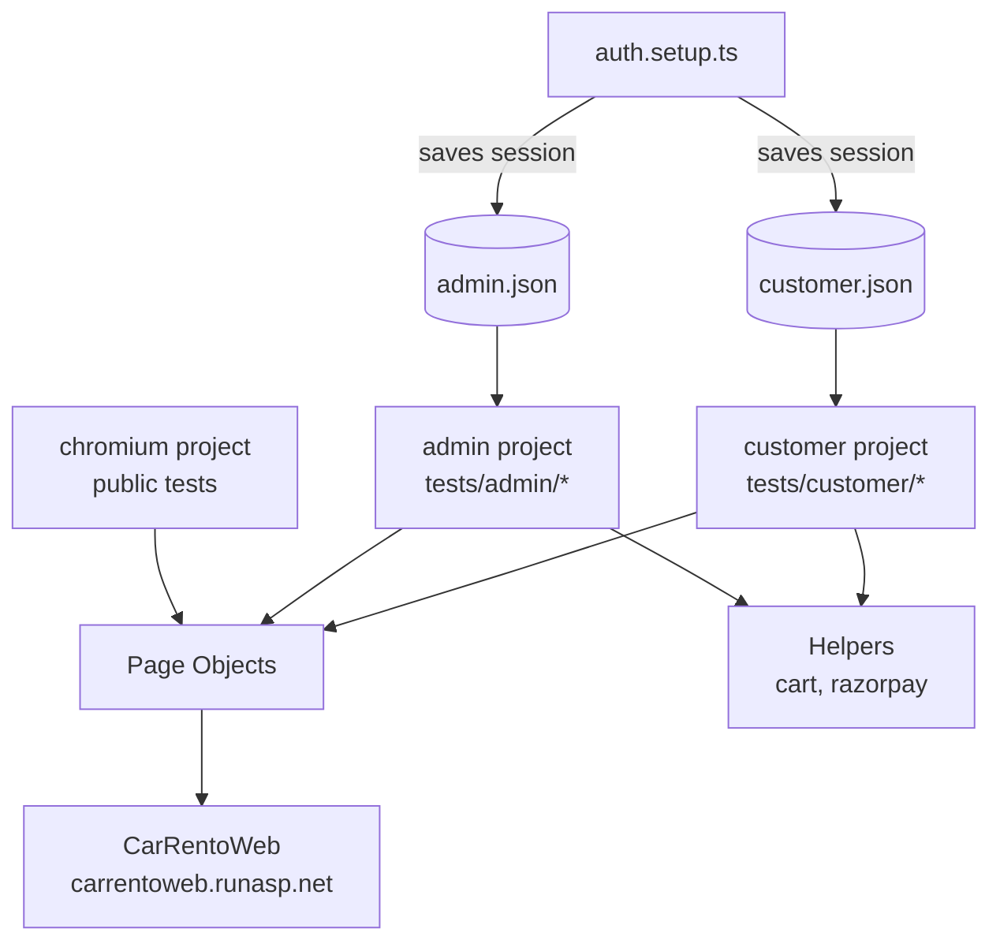

# CarRento Web: Playwright Test Automation

End-to-end test automation for [CarRentoWeb](https://carrentoweb.runasp.net), a car rental
web app built with ASP.NET. Written in **Playwright + TypeScript** using the Page Object Model,
with CI on GitHub Actions.

[](https://gitdiagram.com/vishak486/carrentoweb_playwright_automation?utm_source=readme&utm_medium=badge)

## Features

- **Page Object Model** for maintainable, reusable locators and actions
- **Login once, reuse everywhere** via `storageState` (separate admin and customer sessions)
- **Role-based test projects**: public, admin and customer
- **Multi-user flows**: a visitor sends a contact message and the admin receives and deletes it
- **Stubbed Razorpay checkout**: the payment script is intercepted and the signature is generated
  with HMAC-SHA256, so the full checkout flow runs without a real payment
- **Self-cleaning tests**: test data (brands, cars, carts, orders, messages) is removed or deactivated
- **CI/CD** with GitHub Actions, including HTML report, traces and screenshots on failure

## Tech Stack

Playwright · TypeScript · Node.js · dotenv · GitHub Actions

## Architecture



## Project Structure

```
tests/
├── admin/        # Brands, cars, orders, dashboard, contact flow (admin session)
├── customer/     # Cart, profile, checkout, access control (customer session)
├── helpers/      # cart.ts, razorpay.ts
├── pages/        # Page Objects
├── fixtures/     # Test upload files
├── auth.setup.ts # Logs in once and saves sessions
└── *.spec.ts     # Public tests: login, register, smoke, access
utils/            # Shared utilities (dates)
```

## Getting Started

### Prerequisites
- Node.js (LTS)

### Setup
```bash
git clone https://github.com/vishak486/carrentoweb_playwright_automation.git
cd carrentoweb_playwright_automation
npm ci
npx playwright install chromium
```

### Environment variables
Create a `.env` file in the project root (it is git-ignored):

```env
ADMIN_EMAIL=
ADMIN_PASSWORD=
CUSTOMER_EMAIL=
CUSTOMER_PASSWORD=
RAZORPAY_KEY_SECRET=   # test-mode key only
```

## Running Tests

```bash
npx playwright test                      # run everything
npx playwright test --project=admin      # admin tests only
npx playwright test --project=customer   # customer tests only
npx playwright test --ui                 # interactive UI mode
npx playwright show-report               # open the HTML report
```

## CI/CD

Tests run on every push to `main`/`master` and can be triggered manually.
Credentials are stored as **GitHub Actions secrets**:
`ADMIN_EMAIL`, `ADMIN_PASSWORD`, `CUSTOMER_EMAIL`, `CUSTOMER_PASSWORD`, `RAZORPAY_KEY_SECRET`.

The HTML report is uploaded as a build artifact and kept for 30 days.

## Coverage

| Area | What's tested |
|---|---|
| Public | Smoke test, login (valid/invalid), registration, protected-route redirects |
| Admin | Dashboard, brands, cars, orders, users, contacts, contact-message flow |
| Customer | Profile, browsing, cart totals, checkout and payment, access denial on admin pages |

## Author

**Vishak**: [GitHub](https://github.com/vishak486)
